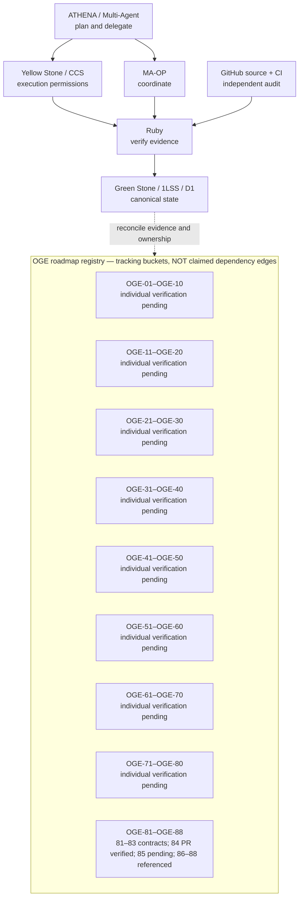

# OGENIC / WAVE — OGE-01 to OGE-88 Visual Workflow Registry

> **Scope:** staging branch only. This file is an evidence-aware **visual index**, not an assertion that all 88 items are complete or that each bucket is an execution dependency. Never use it to approve production actions.

## System architecture (verified contract design, not end-to-end runtime proof)

## All numbered roadmap nodes (01–88)

The numbers below are explicitly represented so no work item silently disappears. **UNVERIFIED** means we have not yet reconciled its title, authoritative ticket, code, CI and runtime evidence. It does NOT mean FAIL, blocked, or completed. OGE-85 is similarly unverified, not assumed absent.

| Node | Evidence status | Known scope / action to verify | Current evidence |
|---|---|---|---|
| OGE-01 | UNVERIFIED | Title, ownership, dependencies and current runtime evidence pending canonical reconciliation | — |
| OGE-02 | UNVERIFIED | Title, ownership, dependencies and current runtime evidence pending canonical reconciliation | — |
| OGE-03 | UNVERIFIED | Title, ownership, dependencies and current runtime evidence pending canonical reconciliation | — |
| OGE-04 | UNVERIFIED | Title, ownership, dependencies and current runtime evidence pending canonical reconciliation | — |
| OGE-05 | UNVERIFIED | Title, ownership, dependencies and current runtime evidence pending canonical reconciliation | — |
| OGE-06 | UNVERIFIED | Title, ownership, dependencies and current runtime evidence pending canonical reconciliation | — |
| OGE-07 | UNVERIFIED | Title, ownership, dependencies and current runtime evidence pending canonical reconciliation | — |
| OGE-08 | UNVERIFIED | Title, ownership, dependencies and current runtime evidence pending canonical reconciliation | — |
| OGE-09 | UNVERIFIED | Title, ownership, dependencies and current runtime evidence pending canonical reconciliation | — |
| OGE-10 | UNVERIFIED | Title, ownership, dependencies and current runtime evidence pending canonical reconciliation | — |
| OGE-11 | UNVERIFIED | Title, ownership, dependencies and current runtime evidence pending canonical reconciliation | — |
| OGE-12 | UNVERIFIED | Title, ownership, dependencies and current runtime evidence pending canonical reconciliation | — |
| OGE-13 | UNVERIFIED | Title, ownership, dependencies and current runtime evidence pending canonical reconciliation | — |
| OGE-14 | UNVERIFIED | Title, ownership, dependencies and current runtime evidence pending canonical reconciliation | — |
| OGE-15 | UNVERIFIED | Title, ownership, dependencies and current runtime evidence pending canonical reconciliation | — |
| OGE-16 | UNVERIFIED | Title, ownership, dependencies and current runtime evidence pending canonical reconciliation | — |
| OGE-17 | UNVERIFIED | Title, ownership, dependencies and current runtime evidence pending canonical reconciliation | — |
| OGE-18 | UNVERIFIED | Title, ownership, dependencies and current runtime evidence pending canonical reconciliation | — |
| OGE-19 | UNVERIFIED | Title, ownership, dependencies and current runtime evidence pending canonical reconciliation | — |
| OGE-20 | UNVERIFIED | Title, ownership, dependencies and current runtime evidence pending canonical reconciliation | — |
| OGE-21 | UNVERIFIED | Title, ownership, dependencies and current runtime evidence pending canonical reconciliation | — |
| OGE-22 | UNVERIFIED | Title, ownership, dependencies and current runtime evidence pending canonical reconciliation | — |
| OGE-23 | UNVERIFIED | Title, ownership, dependencies and current runtime evidence pending canonical reconciliation | — |
| OGE-24 | UNVERIFIED | Title, ownership, dependencies and current runtime evidence pending canonical reconciliation | — |
| OGE-25 | UNVERIFIED | Title, ownership, dependencies and current runtime evidence pending canonical reconciliation | — |
| OGE-26 | UNVERIFIED | Title, ownership, dependencies and current runtime evidence pending canonical reconciliation | — |
| OGE-27 | UNVERIFIED | Title, ownership, dependencies and current runtime evidence pending canonical reconciliation | — |
| OGE-28 | UNVERIFIED | Title, ownership, dependencies and current runtime evidence pending canonical reconciliation | — |
| OGE-29 | UNVERIFIED | Title, ownership, dependencies and current runtime evidence pending canonical reconciliation | — |
| OGE-30 | UNVERIFIED | Title, ownership, dependencies and current runtime evidence pending canonical reconciliation | — |
| OGE-31 | UNVERIFIED | Title, ownership, dependencies and current runtime evidence pending canonical reconciliation | — |
| OGE-32 | UNVERIFIED | Title, ownership, dependencies and current runtime evidence pending canonical reconciliation | — |
| OGE-33 | UNVERIFIED | Title, ownership, dependencies and current runtime evidence pending canonical reconciliation | — |
| OGE-34 | UNVERIFIED | Title, ownership, dependencies and current runtime evidence pending canonical reconciliation | — |
| OGE-35 | UNVERIFIED | Title, ownership, dependencies and current runtime evidence pending canonical reconciliation | — |
| OGE-36 | UNVERIFIED | Title, ownership, dependencies and current runtime evidence pending canonical reconciliation | — |
| OGE-37 | UNVERIFIED | Title, ownership, dependencies and current runtime evidence pending canonical reconciliation | — |
| OGE-38 | UNVERIFIED | Title, ownership, dependencies and current runtime evidence pending canonical reconciliation | — |
| OGE-39 | UNVERIFIED | Title, ownership, dependencies and current runtime evidence pending canonical reconciliation | — |
| OGE-40 | UNVERIFIED | Title, ownership, dependencies and current runtime evidence pending canonical reconciliation | — |
| OGE-41 | UNVERIFIED | Title, ownership, dependencies and current runtime evidence pending canonical reconciliation | — |
| OGE-42 | UNVERIFIED | Title, ownership, dependencies and current runtime evidence pending canonical reconciliation | — |
| OGE-43 | UNVERIFIED | Title, ownership, dependencies and current runtime evidence pending canonical reconciliation | — |
| OGE-44 | UNVERIFIED | Title, ownership, dependencies and current runtime evidence pending canonical reconciliation | — |
| OGE-45 | UNVERIFIED | Title, ownership, dependencies and current runtime evidence pending canonical reconciliation | — |
| OGE-46 | UNVERIFIED | Title, ownership, dependencies and current runtime evidence pending canonical reconciliation | — |
| OGE-47 | UNVERIFIED | Title, ownership, dependencies and current runtime evidence pending canonical reconciliation | — |
| OGE-48 | UNVERIFIED | Title, ownership, dependencies and current runtime evidence pending canonical reconciliation | — |
| OGE-49 | UNVERIFIED | Title, ownership, dependencies and current runtime evidence pending canonical reconciliation | — |
| OGE-50 | UNVERIFIED | Title, ownership, dependencies and current runtime evidence pending canonical reconciliation | — |
| OGE-51 | UNVERIFIED | Title, ownership, dependencies and current runtime evidence pending canonical reconciliation | — |
| OGE-52 | UNVERIFIED | Title, ownership, dependencies and current runtime evidence pending canonical reconciliation | — |
| OGE-53 | UNVERIFIED | Title, ownership, dependencies and current runtime evidence pending canonical reconciliation | — |
| OGE-54 | UNVERIFIED | Title, ownership, dependencies and current runtime evidence pending canonical reconciliation | — |
| OGE-55 | UNVERIFIED | Title, ownership, dependencies and current runtime evidence pending canonical reconciliation | — |
| OGE-56 | UNVERIFIED | Title, ownership, dependencies and current runtime evidence pending canonical reconciliation | — |
| OGE-57 | UNVERIFIED | Title, ownership, dependencies and current runtime evidence pending canonical reconciliation | — |
| OGE-58 | UNVERIFIED | Title, ownership, dependencies and current runtime evidence pending canonical reconciliation | — |
| OGE-59 | UNVERIFIED | Title, ownership, dependencies and current runtime evidence pending canonical reconciliation | — |
| OGE-60 | UNVERIFIED | Title, ownership, dependencies and current runtime evidence pending canonical reconciliation | — |
| OGE-61 | UNVERIFIED | Title, ownership, dependencies and current runtime evidence pending canonical reconciliation | — |
| OGE-62 | UNVERIFIED | Title, ownership, dependencies and current runtime evidence pending canonical reconciliation | — |
| OGE-63 | UNVERIFIED | Title, ownership, dependencies and current runtime evidence pending canonical reconciliation | — |
| OGE-64 | UNVERIFIED | Title, ownership, dependencies and current runtime evidence pending canonical reconciliation | — |
| OGE-65 | UNVERIFIED | Title, ownership, dependencies and current runtime evidence pending canonical reconciliation | — |
| OGE-66 | UNVERIFIED | Title, ownership, dependencies and current runtime evidence pending canonical reconciliation | — |
| OGE-67 | UNVERIFIED | Title, ownership, dependencies and current runtime evidence pending canonical reconciliation | — |
| OGE-68 | UNVERIFIED | Title, ownership, dependencies and current runtime evidence pending canonical reconciliation | — |
| OGE-69 | UNVERIFIED | Title, ownership, dependencies and current runtime evidence pending canonical reconciliation | — |
| OGE-70 | UNVERIFIED | Title, ownership, dependencies and current runtime evidence pending canonical reconciliation | — |
| OGE-71 | UNVERIFIED | Title, ownership, dependencies and current runtime evidence pending canonical reconciliation | — |
| OGE-72 | UNVERIFIED | Title, ownership, dependencies and current runtime evidence pending canonical reconciliation | — |
| OGE-73 | UNVERIFIED | Title, ownership, dependencies and current runtime evidence pending canonical reconciliation | — |
| OGE-74 | UNVERIFIED | Title, ownership, dependencies and current runtime evidence pending canonical reconciliation | — |
| OGE-75 | UNVERIFIED | Title, ownership, dependencies and current runtime evidence pending canonical reconciliation | — |
| OGE-76 | UNVERIFIED | Title, ownership, dependencies and current runtime evidence pending canonical reconciliation | — |
| OGE-77 | UNVERIFIED | Title, ownership, dependencies and current runtime evidence pending canonical reconciliation | — |
| OGE-78 | UNVERIFIED | Title, ownership, dependencies and current runtime evidence pending canonical reconciliation | — |
| OGE-79 | UNVERIFIED | Title, ownership, dependencies and current runtime evidence pending canonical reconciliation | — |
| OGE-80 | UNVERIFIED | Title, ownership, dependencies and current runtime evidence pending canonical reconciliation | — |
| OGE-81 | VERIFIED-CONTRACT | operation identity, approval binding, bounded retry and stale-writer fencing | audit/OGE-84_FINAL_VERIFY.md |
| OGE-82 | VERIFIED-CONTRACT | delegated authority, revocation, egress scope, invocation authorization | audit/OGE-84_FINAL_VERIFY.md |
| OGE-83 | VERIFIED-CONTRACT | provenance, Ruby promotion gate, 1LSS conflict handling, deletion receipts | audit/OGE-84_FINAL_VERIFY.md |
| OGE-84 | PR-MERGED+CI-PASS | canonical recovery verification (staging only) | PR #11 / workflow 37714740729 and 37714740742 |
| OGE-85 | UNVERIFIED | Title, ownership, dependencies and current runtime evidence pending canonical reconciliation | — |
| OGE-86 | ARCHITECTURE-REFERENCED | architecture grouping / mapping (individual closure not verified) | audit/OGE-84_FINAL_VERIFY.md |
| OGE-87 | ARCHITECTURE-REFERENCED | architecture grouping / mapping (individual closure not verified) | audit/OGE-84_FINAL_VERIFY.md |
| OGE-88 | ARCHITECTURE-REFERENCED | future closure visual standard | audit/OGE-84_FINAL_VERIFY.md |

## Closure protocol (OGE-88 visual evidence)

For each number, resolve its canonical title and owning agent/issue, predecessor/dependency links, source PR/commit and branch, CI run with conclusion, verification evidence, and runtime proof (if required). Assign `DONE` only after the required independent gate and evidence have passed; otherwise `IN_PROGRESS`, `BLOCKED`, `FAIL` or `UNVERIFIED` with reason. Attach a per-task closure image/diagram when available. A PR merge by itself is not runtime certification.

**Source confirmed on 2026-10-08:** PR #11 merged into `phase-vi-provider-incentive-metering` with merge commit `100da69639dc5585fdb97a2073619b5b7de79236`. Head `d26d986a68713d4238863900b1e5a1a22d4fe89c` had successful workflows `37714740729` (Validate and Bundle Phase VI) and `37714740742` (MA-OP Web Lab Proof). The OGE-84 audit references OGE-81/82/83 and OGE-86/87/88. These are **not** proof that every node 01–88 is finished.

## Next reconciliation run

1. Query authoritative issue/roadmap records by OGE ID to replace UNVERIFIED rows with real titles and status.
2. Add dependency arrows only where repository/ticket evidence supports them.
3. Attach GitHub PR, CI and Ruby/runtime receipts to each row.
4. Publish grouped mobile-friendly diagrams + image receipts at closure; keep canonical 1LSS/D1 as system-of-record.
5. Return to pending work after visualization registry reconciliation without touching main, prod, Candy, secrets or D1 schema.
