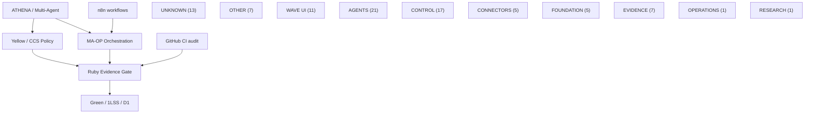

# OGENIC / WAVE — OGE 01–88 Live Linear-Sourced Visual Map

> Generated from **Linear issue search** on 2026-10-08, staging documentation only. Linear status is an issue-tracker claim, NOT independent runtime proof. This is an inventory, not a generated dependency DAG.

## Canonical execution architecture

## Mobile-first grouped map

### UNKNOWN — 13 issues

- [OGE-1](https://linear.app/ogenic-sio): **NOT FOUND** — Needs reconciliation
- [OGE-2](https://linear.app/ogenic-sio): **NOT FOUND** — Needs reconciliation
- [OGE-3](https://linear.app/ogenic-sio): **NOT FOUND** — Needs reconciliation
- [OGE-4](https://linear.app/ogenic-sio): **NOT FOUND** — Needs reconciliation
- [OGE-15](https://linear.app/ogenic-sio): **NOT FOUND** — Needs reconciliation
- [OGE-21](https://linear.app/ogenic-sio): **NOT FOUND** — Needs reconciliation
- [OGE-39](https://linear.app/ogenic-sio): **NOT FOUND** — Needs reconciliation
- [OGE-59](https://linear.app/ogenic-sio): **NOT FOUND** — Needs reconciliation
- [OGE-60](https://linear.app/ogenic-sio): **NOT FOUND** — Needs reconciliation
- [OGE-62](https://linear.app/ogenic-sio): **NOT FOUND** — Needs reconciliation
- [OGE-64](https://linear.app/ogenic-sio): **NOT FOUND** — Needs reconciliation
- [OGE-65](https://linear.app/ogenic-sio): **NOT FOUND** — Needs reconciliation
- [OGE-81](https://linear.app/ogenic-sio): **NOT FOUND** — Needs reconciliation

### OTHER — 7 issues

- [OGE-5](https://linear.app/ogenic-sio/issue/OGE-5/frozen-candy-a1-a6-drivedocsrepo-canonical-sync): **Backlog** — FROZEN — CANDY A1-A6 Drive/Docs/Repo Canonical Sync
- [OGE-6](https://linear.app/ogenic-sio/issue/OGE-6/phase-vi-api-linear-d1-task-binding): **Done** — Phase VI API — Linear ↔ D1 Task Binding
- [OGE-12](https://linear.app/ogenic-sio/issue/OGE-12/later-openai-platform-ops-vector-store-admin-module): **Backlog** — LATER — OpenAI Platform Ops / Vector Store Admin module
- [OGE-19](https://linear.app/ogenic-sio/issue/OGE-19/quick-win-actual-app-capability-matrix): **Done** — Quick Win — Actual App Capability Matrix · delegate Codex
- [OGE-25](https://linear.app/ogenic-sio/issue/OGE-25/ys-v1-slice-1-deterministic-capability-resolver-read-only-facade): **Done** — YS v1 Slice 1 — deterministic capability resolver + read-only facade · delegate Codex
- [OGE-72](https://linear.app/ogenic-sio/issue/OGE-72/resource-placement-vercel-preview-arm-clickup-collaboration-arm-notion): **Done** — RESOURCE PLACEMENT — Vercel preview arm + ClickUp collaboration arm + Notion legacy source
- [OGE-85](https://linear.app/ogenic-sio/issue/OGE-85/architecture-exhibition-map-group-oge-1-80-and-render-one-connected): **Done** — ARCHITECTURE EXHIBITION MAP — Group OGE 1–80+ and render one connected system diagram

### WAVE UI — 11 issues

- [OGE-7](https://linear.app/ogenic-sio/issue/OGE-7/phase-vi-tools-mobile-ops-uxui-dashboard): **Done** — Phase VI Tools — Mobile Ops UX/UI Dashboard
- [OGE-13](https://linear.app/ogenic-sio/issue/OGE-13/superseded-legacy-compact-dashboard-gm-cashflow-app-hub-layout): **Canceled** — SUPERSEDED — legacy compact dashboard / GM / Cashflow / App Hub layout
- [OGE-20](https://linear.app/ogenic-sio/issue/OGE-20/superseded-old-wave-mobile-ia-chat-work-live-apps-more): **Canceled** — SUPERSEDED — old WAVE Mobile IA (Chat / Work / Live / Apps / More)
- [OGE-22](https://linear.app/ogenic-sio/issue/OGE-22/master-ogenicwave-canonical-execution-graph-dependency-order): **Done** — MASTER — OGENIC/WAVE canonical execution graph + dependency order
- [OGE-45](https://linear.app/ogenic-sio/issue/OGE-45/roadmap-burn-down-reconcile-remaining-wave-work-into-oge-queue): **Done** — ROADMAP BURN-DOWN — Reconcile Remaining WAVE Work into OGE Queue · delegate Codex
- [OGE-50](https://linear.app/ogenic-sio/issue/OGE-50/wave-operate-jobs-run-history-evidence-references): **Done** — WAVE OPERATE — Jobs + Run History + Evidence References
- [OGE-51](https://linear.app/ogenic-sio/issue/OGE-51/wave-composer-attachment-reliability-core-device-proof-deferred): **Done** — WAVE COMPOSER — Attachment Reliability Core (device proof deferred)
- [OGE-52](https://linear.app/ogenic-sio/issue/OGE-52/wave-signals-real-notifications-from-runtime-state): **Done** — WAVE SIGNALS — Real Notifications from Runtime State
- [OGE-53](https://linear.app/ogenic-sio/issue/OGE-53/wave-composer-capability-dock-v1-search-honest-connected-states): **Done** — WAVE COMPOSER — Capability Dock V1 · Search · Honest Connected States
- [OGE-63](https://linear.app/ogenic-sio/issue/OGE-63/wave-chat-finish-neonacrylic-messages-real-action-bar-evidence-link): **Done** — WAVE CHAT FINISH — Neon/Acrylic messages + real action bar + evidence link
- [OGE-77](https://linear.app/ogenic-sio/issue/OGE-77/wave-web-v2-vercel-style-dashboard-3-execution-channels): **In Progress** — WAVE WEB V2 — Vercel-style dashboard + 3 execution channels

### AGENTS — 21 issues

- [OGE-8](https://linear.app/ogenic-sio/issue/OGE-8/phase-vi-agents-runtime-adapters-and-heartbeats): **Canceled** — Phase VI Agents — Runtime Adapters & Heartbeats · delegate Codex
- [OGE-30](https://linear.app/ogenic-sio/issue/OGE-30/white-diamond-openai-commander-agent-registry-no-direct-execution): **Done** — WHITE DIAMOND — OpenAI Commander + Agent Registry (no direct execution bypass) · delegate Codex
- [OGE-31](https://linear.app/ogenic-sio/issue/OGE-31/wave-next-run-first-agent-surface-live-agent-presence): **Done** — WAVE NEXT — Run-first Agent Surface + Live Agent Presence · delegate Codex
- [OGE-34](https://linear.app/ogenic-sio/issue/OGE-34/athena-default-wave-chat-bridge-verified-read-only-auto-tools): **Done** — ATHENA default WAVE chat bridge — verified read-only auto tools · delegate Codex
- [OGE-37](https://linear.app/ogenic-sio/issue/OGE-37/stone-v-violet-stone-multi-agent-solution-work-operate): **Done** — STONE V — VIOLET STONE: Multi-Agent · Solution · Work · Operate
- [OGE-41](https://linear.app/ogenic-sio/issue/OGE-41/ma-op-multi-agent-operations-protocol-architecture-draft): **Done** — MA-OP — Multi-Agent Operations Protocol Architecture Draft · delegate Codex
- [OGE-43](https://linear.app/ogenic-sio/issue/OGE-43/github-capability-plugin-ma-op-deepseek-harness-bridge): **Done** — GITHUB CAPABILITY PLUGIN — MA-OP ↔ DeepSeek Harness Bridge · delegate Codex
- [OGE-44](https://linear.app/ogenic-sio/issue/OGE-44/wave-surface-routing-separate-chat-command-agent-and-operate): **Done** — WAVE SURFACE ROUTING — Separate Chat, Command, Agent and Operate · delegate Codex
- [OGE-46](https://linear.app/ogenic-sio/issue/OGE-46/wave-capacity-status-live-quota-percentages-in-agent-style-status-deck): **Done** — WAVE CAPACITY STATUS — Live Quota Percentages in Agent-style Status Deck · delegate Codex
- [OGE-47](https://linear.app/ogenic-sio/issue/OGE-47/parallel-agent-runtime-linearcodex-codex-claude-isolated-lanes): **Done** — PARALLEL AGENT RUNTIME — Linear/Codex + Codex + Claude isolated lanes · delegate Codex
- [OGE-49](https://linear.app/ogenic-sio/issue/OGE-49/ma-op-mvp-slice-1-core-contracts-reference-runtime-zero-cost): **Done** — MA-OP MVP SLICE 1 — Core contracts + reference runtime + zero-cost conformance
- [OGE-58](https://linear.app/ogenic-sio/issue/OGE-58/perplexity-agent-bridge-web-grounded-research-capability-safe-one-pass): **Done** — PERPLEXITY AGENT BRIDGE — Web-grounded research capability + safe one-pass smoke
- [OGE-66](https://linear.app/ogenic-sio/issue/OGE-66/ma-op-first-impression-protocol-negotiation-evidence-freshness-bounded): **Done** — MA-OP FIRST IMPRESSION — Protocol negotiation, evidence freshness, bounded harness inputs
- [OGE-67](https://linear.app/ogenic-sio/issue/OGE-67/ma-op-web-lab-real-staging-surface-for-core-github-read-ruby-proof): **Done** — MA-OP WEB LAB — Real staging surface for Core + GitHub READ + Ruby proof
- [OGE-69](https://linear.app/ogenic-sio/issue/OGE-69/n8n-self-host-migration-categorize-legacy-ogenic-modules-and-stage-ma): **Done** — N8N SELF-HOST MIGRATION — Categorize legacy OGENIC modules and stage MA-OP connector
- [OGE-71](https://linear.app/ogenic-sio/issue/OGE-71/ai-role-placement-promote-verified-providers-into-real-multi-agent): **In Progress** — AI ROLE PLACEMENT — Promote verified providers into real multi-agent execution lanes · delegate Codex
- [OGE-73](https://linear.app/ogenic-sio/issue/OGE-73/wave-phase-ii-finalize-core-agent-roster-canonical-routing-specialist): **In Progress** — WAVE PHASE II FINALIZE — Core agent roster → canonical routing → specialist activation · delegate Codex
- [OGE-74](https://linear.app/ogenic-sio/issue/OGE-74/global-agent-context-budget-enforce-bounded-context-across-every): **In Progress** — GLOBAL AGENT CONTEXT BUDGET — Enforce bounded context across every provider · delegate Codex
- [OGE-78](https://linear.app/ogenic-sio/issue/OGE-78/use-card-50-in-1-ma-op-permission-wrapper-bounded-card-lease): **Done** — USE CARD 50-IN-1 — MA-OP permission wrapper + bounded card lease · delegate Codex
- [OGE-80](https://linear.app/ogenic-sio/issue/OGE-80/astra-minimal-hardening-v1-distill-research-into-smallest-ogenic): **Done** — ASTRA MINIMAL HARDENING V1 — Distill research into smallest OGENIC safety upgrade
- [OGE-84](https://linear.app/ogenic-sio/issue/OGE-84/ruby-final-verify-merge-astra-hardening-evidence-run-failure-injection): **Done** — RUBY FINAL VERIFY — Merge Astra hardening evidence, run failure-injection matrix, close only on proof · delegate Codex

### CONTROL — 17 issues

- [OGE-9](https://linear.app/ogenic-sio/issue/OGE-9/later-public-developer-api-js-workspace-after-core-control-plane): **Backlog** — LATER — Public Developer API / JS Workspace after core control plane
- [OGE-10](https://linear.app/ogenic-sio/issue/OGE-10/frozen-candy-codex-control-via-linear-dispatch): **Backlog** — FROZEN — Candy Codex control via Linear dispatch
- [OGE-11](https://linear.app/ogenic-sio/issue/OGE-11/web-dev-same-mind-sync-openai-control-plane): **Done** — Web Dev — SAME MIND sync + OpenAI Control Plane · delegate Codex
- [OGE-14](https://linear.app/ogenic-sio/issue/OGE-14/cloudflare-control-router-function-calls-hooks-n8n-adapter): **Done** — Cloudflare Control Router — Function Calls + Hooks + n8n Adapter · delegate Codex
- [OGE-16](https://linear.app/ogenic-sio/issue/OGE-16/later-native-ios-shell-after-wave-next-webcontrol-contracts-stabilize): **Backlog** — LATER — Native iOS shell after WAVE NEXT web/control contracts stabilize
- [OGE-23](https://linear.app/ogenic-sio/issue/OGE-23/superseded-historical-yellow-stone-repo-reuse-audit): **Canceled** — SUPERSEDED — historical Yellow Stone repo reuse audit
- [OGE-24](https://linear.app/ogenic-sio/issue/OGE-24/superseded-historical-yellow-stone-gap-audit): **Canceled** — SUPERSEDED — historical Yellow Stone gap audit
- [OGE-26](https://linear.app/ogenic-sio/issue/OGE-26/ys-v1-slice-2-guarded-execution-router-approvalevidence-envelope): **Done** — YS v1 Slice 2 — guarded execution router + approval/evidence envelope · delegate Codex
- [OGE-27](https://linear.app/ogenic-sio/issue/OGE-27/wave-browser-control-cloudflare-live-view-hitl-recording-evidence): **Done** — WAVE Browser Control — Cloudflare Live View + HITL + recording evidence · delegate Codex
- [OGE-28](https://linear.app/ogenic-sio/issue/OGE-28/codex-left-arm-cloudflareyellow-stone-self-host-ssh-wave-wave-runner): **Done** — CODEX LEFT ARM — Cloudflare/Yellow Stone → self-host SSH-WAVE / wave-runner-01 · delegate Codex
- [OGE-33](https://linear.app/ogenic-sio/issue/OGE-33/blue-diamond-athena-admission-control-stone-iv): **Done** — Blue Diamond / ATHENA admission control — Stone IV
- [OGE-35](https://linear.app/ogenic-sio/issue/OGE-35/athena-guarded-command-handoff-yellow-stone-executionapproval): **Done** — ATHENA guarded command handoff → Yellow Stone execution/approval · delegate Codex
- [OGE-36](https://linear.app/ogenic-sio/issue/OGE-36/athena-natural-language-command-planner-deterministic-yellow-stone): **Done** — ATHENA natural-language command planner → deterministic Yellow Stone plan
- [OGE-56](https://linear.app/ogenic-sio/issue/OGE-56/auto-routing-v1-caprank-readiness-cost-yellow-policy-selection): **Done** — AUTO ROUTING V1 — CapRank + readiness + cost + Yellow policy selection
- [OGE-70](https://linear.app/ogenic-sio/issue/OGE-70/n8n-execution-fabric-place-oge-workflow-native-lanes-behind-ma): **Done** — N8N EXECUTION FABRIC — Place OGE workflow-native lanes behind MA-OP/Yellow
- [OGE-79](https://linear.app/ogenic-sio/issue/OGE-79/ccs-protocol-capability-card-stone-agent-connection-language): **Done** — CCS PROTOCOL — Capability Card Stone agent connection language · delegate Codex
- [OGE-82](https://linear.app/ogenic-sio/issue/OGE-82/ccs-authority-hardening-delegation-revocation-credential-custody): **Done** — CCS AUTHORITY HARDENING — Delegation, revocation, credential custody, egress enforcement · delegate Codex

### CONNECTORS — 5 issues

- [OGE-17](https://linear.app/ogenic-sio/issue/OGE-17/wave-mobile-unified-plugin-registry-actual-app-inventory): **Done** — WAVE Mobile — Unified Plugin Registry + Actual App Inventory · delegate Codex
- [OGE-29](https://linear.app/ogenic-sio/issue/OGE-29/wave-mcp-config-center-on-website-real-config-tool-discovery): **Done** — WAVE — MCP Config Center on website (real config + tool discovery) · delegate Codex
- [OGE-32](https://linear.app/ogenic-sio/issue/OGE-32/openai-platform-private-tool-bridge-function-tools-first-optional-mcp): **Done** — OpenAI Platform Private Tool Bridge — Function Tools first + optional MCP · delegate Codex
- [OGE-68](https://linear.app/ogenic-sio/issue/OGE-68/superseded-n8n-legacy-source-bridge-recovered-exports-used-for-self): **Canceled** — SUPERSEDED — N8N LEGACY SOURCE BRIDGE (recovered exports used for self-host migration) · delegate Codex
- [OGE-87](https://linear.app/ogenic-sio/issue/OGE-87/arch-map-step-2-render-github-wave-blackwhite-n8n-style-architecture): **Done** — ARCH MAP STEP 2 — Render GitHub + WAVE black/white n8n-style architecture diagram · delegate Codex

### FOUNDATION — 5 issues

- [OGE-18](https://linear.app/ogenic-sio/issue/OGE-18/ogenic-project-session-project-resolver-wave): **Canceled** — OGENIC — Project Session → Project Resolver → WAVE
- [OGE-48](https://linear.app/ogenic-sio/issue/OGE-48/one-pass-runtime-refinery-runtime-clones-perplexity-docker-ruby-green): **Done** — ONE-PASS RUNTIME REFINERY — Runtime Clones → Perplexity → Docker → Ruby → Green
- [OGE-54](https://linear.app/ogenic-sio/issue/OGE-54/wave-agent-continuation-durable-openai-agent-session-without-context): **Done** — WAVE AGENT CONTINUATION — Durable OpenAI Agent Session without context replay
- [OGE-57](https://linear.app/ogenic-sio/issue/OGE-57/wave-task-inbox-core-cross-session-assignment-owner-main-result-trail): **Done** — WAVE TASK INBOX CORE — Cross-session assignment + owner-main result trail
- [OGE-83](https://linear.app/ogenic-sio/issue/OGE-83/rubygreen-hardening-provenance-canonical-promotion-provider-session): **Done** — RUBY→GREEN HARDENING — Provenance, canonical promotion, provider-session projection, retention proof · delegate Codex

### EVIDENCE — 7 issues

- [OGE-38](https://linear.app/ogenic-sio/issue/OGE-38/stone-vi-ruby-stone-system-and-ai-capability-test-layer): **Done** — STONE VI — RUBY STONE: System & AI Capability Test Layer
- [OGE-55](https://linear.app/ogenic-sio/issue/OGE-55/capsig-caprank-v1-ruby-evidence-capability-signatures-and-ranking): **Done** — CapSig / CapRank V1 — Ruby-evidence capability signatures and ranking
- [OGE-61](https://linear.app/ogenic-sio/issue/OGE-61/runtime-10-ten-isolated-parallel-clones-serial-reducer-proof): **Done** — RUNTIME ×10 — Ten isolated parallel clones + serial reducer proof
- [OGE-75](https://linear.app/ogenic-sio/issue/OGE-75/xai-meta-provider-proof-verify-infisical-bindings-and-promote-only): **Canceled** — XAI + META PROVIDER PROOF — Verify Infisical bindings and promote only live providers · delegate Codex
- [OGE-76](https://linear.app/ogenic-sio/issue/OGE-76/phase-ii-canonical-audit-re-check-oge-717274-on-fresh-branch-head): **Canceled** — PHASE II CANONICAL AUDIT — Re-check OGE-71/72/74 on fresh branch head · delegate Codex
- [OGE-86](https://linear.app/ogenic-sio/issue/OGE-86/arch-map-step-1-reconcile-oge-1-80-into-functional-groups-audited): **Done** — ARCH MAP STEP 1 — Reconcile OGE 1–80+ into functional groups + audited edges · delegate Codex
- [OGE-88](https://linear.app/ogenic-sio/issue/OGE-88/oge-closure-visual-standard-every-closed-issue-gets-one-github-visual): **Done** — OGE CLOSURE VISUAL STANDARD — Every closed issue gets one GitHub visual proof · delegate Codex

### OPERATIONS — 1 issues

- [OGE-40](https://linear.app/ogenic-sio/issue/OGE-40/realtime-ops-provider-readiness-and-cost-safe-routing): **Done** — REALTIME OPS — Provider Readiness & Cost-Safe Routing · delegate Codex

### RESEARCH — 1 issues

- [OGE-42](https://linear.app/ogenic-sio/issue/OGE-42/knowledge-refinery-v2-code-debug-build-create-rule-formula): **Done** — KNOWLEDGE REFINERY V2 — Code / Debug / Build / Create → Rule / Formula Distillation · delegate Codex

## Full numbered roster

| Issue | Title | Primary group | Linear status | Existing delegate |
|---|---|---|---|---|
| [OGE-1](https://linear.app/ogenic-sio/issue/OGE-1/get-familiar-with-linear) | Get familiar with Linear | ONBOARDING | Todo | — |
| [OGE-2](https://linear.app/ogenic-sio/issue/OGE-2/connect-your-tools) | Connect your tools | ONBOARDING | Todo | — |
| [OGE-3](https://linear.app/ogenic-sio/issue/OGE-3/import-your-data) | Import your data | ONBOARDING | Todo | — |
| [OGE-4](https://linear.app/ogenic-sio/issue/OGE-4/set-up-your-teams) | Set up your teams | ONBOARDING | Todo | — |
| [OGE-5](https://linear.app/ogenic-sio/issue/OGE-5/frozen-candy-a1-a6-drivedocsrepo-canonical-sync) | FROZEN — CANDY A1-A6 Drive/Docs/Repo Canonical Sync | OTHER | Backlog | — |
| [OGE-6](https://linear.app/ogenic-sio/issue/OGE-6/phase-vi-api-linear-d1-task-binding) | Phase VI API — Linear ↔ D1 Task Binding | OTHER | Done | — |
| [OGE-7](https://linear.app/ogenic-sio/issue/OGE-7/phase-vi-tools-mobile-ops-uxui-dashboard) | Phase VI Tools — Mobile Ops UX/UI Dashboard | WAVE UI | Done | — |
| [OGE-8](https://linear.app/ogenic-sio/issue/OGE-8/phase-vi-agents-runtime-adapters-and-heartbeats) | Phase VI Agents — Runtime Adapters & Heartbeats | AGENTS | Canceled | Codex |
| [OGE-9](https://linear.app/ogenic-sio/issue/OGE-9/later-public-developer-api-js-workspace-after-core-control-plane) | LATER — Public Developer API / JS Workspace after core control plane | CONTROL | Backlog | — |
| [OGE-10](https://linear.app/ogenic-sio/issue/OGE-10/frozen-candy-codex-control-via-linear-dispatch) | FROZEN — Candy Codex control via Linear dispatch | CONTROL | Backlog | — |
| [OGE-11](https://linear.app/ogenic-sio/issue/OGE-11/web-dev-same-mind-sync-openai-control-plane) | Web Dev — SAME MIND sync + OpenAI Control Plane | CONTROL | Done | Codex |
| [OGE-12](https://linear.app/ogenic-sio/issue/OGE-12/later-openai-platform-ops-vector-store-admin-module) | LATER — OpenAI Platform Ops / Vector Store Admin module | OTHER | Backlog | — |
| [OGE-13](https://linear.app/ogenic-sio/issue/OGE-13/superseded-legacy-compact-dashboard-gm-cashflow-app-hub-layout) | SUPERSEDED — legacy compact dashboard / GM / Cashflow / App Hub layout | WAVE UI | Canceled | — |
| [OGE-14](https://linear.app/ogenic-sio/issue/OGE-14/cloudflare-control-router-function-calls-hooks-n8n-adapter) | Cloudflare Control Router — Function Calls + Hooks + n8n Adapter | CONTROL | Done | Codex |
| [OGE-15](https://linear.app/ogenic-sio/issue/OGE-15/web-dev-provider-connect-wizard-oauthmcpdirect-api-no-token-hunting) | Web Dev — Provider Connect Wizard (OAuth/MCP/Direct API, no token hunting) | CONNECTORS | Canceled | Codex |
| [OGE-16](https://linear.app/ogenic-sio/issue/OGE-16/later-native-ios-shell-after-wave-next-webcontrol-contracts-stabilize) | LATER — Native iOS shell after WAVE NEXT web/control contracts stabilize | CONTROL | Backlog | — |
| [OGE-17](https://linear.app/ogenic-sio/issue/OGE-17/wave-mobile-unified-plugin-registry-actual-app-inventory) | WAVE Mobile — Unified Plugin Registry + Actual App Inventory | CONNECTORS | Done | Codex |
| [OGE-18](https://linear.app/ogenic-sio/issue/OGE-18/ogenic-project-session-project-resolver-wave) | OGENIC — Project Session → Project Resolver → WAVE | FOUNDATION | Canceled | — |
| [OGE-19](https://linear.app/ogenic-sio/issue/OGE-19/quick-win-actual-app-capability-matrix) | Quick Win — Actual App Capability Matrix | OTHER | Done | Codex |
| [OGE-20](https://linear.app/ogenic-sio/issue/OGE-20/superseded-old-wave-mobile-ia-chat-work-live-apps-more) | SUPERSEDED — old WAVE Mobile IA (Chat / Work / Live / Apps / More) | WAVE UI | Canceled | — |
| [OGE-21](https://linear.app/ogenic-sio) | Not found in returned Linear search | UNKNOWN | NOT FOUND | — |
| [OGE-22](https://linear.app/ogenic-sio/issue/OGE-22/master-ogenicwave-canonical-execution-graph-dependency-order) | MASTER — OGENIC/WAVE canonical execution graph + dependency order | WAVE UI | Done | — |
| [OGE-23](https://linear.app/ogenic-sio/issue/OGE-23/superseded-historical-yellow-stone-repo-reuse-audit) | SUPERSEDED — historical Yellow Stone repo reuse audit | CONTROL | Canceled | — |
| [OGE-24](https://linear.app/ogenic-sio/issue/OGE-24/superseded-historical-yellow-stone-gap-audit) | SUPERSEDED — historical Yellow Stone gap audit | CONTROL | Canceled | — |
| [OGE-25](https://linear.app/ogenic-sio/issue/OGE-25/ys-v1-slice-1-deterministic-capability-resolver-read-only-facade) | YS v1 Slice 1 — deterministic capability resolver + read-only facade | OTHER | Done | Codex |
| [OGE-26](https://linear.app/ogenic-sio/issue/OGE-26/ys-v1-slice-2-guarded-execution-router-approvalevidence-envelope) | YS v1 Slice 2 — guarded execution router + approval/evidence envelope | CONTROL | Done | Codex |
| [OGE-27](https://linear.app/ogenic-sio/issue/OGE-27/wave-browser-control-cloudflare-live-view-hitl-recording-evidence) | WAVE Browser Control — Cloudflare Live View + HITL + recording evidence | CONTROL | Done | Codex |
| [OGE-28](https://linear.app/ogenic-sio/issue/OGE-28/codex-left-arm-cloudflareyellow-stone-self-host-ssh-wave-wave-runner) | CODEX LEFT ARM — Cloudflare/Yellow Stone → self-host SSH-WAVE / wave-runner-01 | CONTROL | Done | Codex |
| [OGE-29](https://linear.app/ogenic-sio/issue/OGE-29/wave-mcp-config-center-on-website-real-config-tool-discovery) | WAVE — MCP Config Center on website (real config + tool discovery) | CONNECTORS | Done | Codex |
| [OGE-30](https://linear.app/ogenic-sio/issue/OGE-30/white-diamond-openai-commander-agent-registry-no-direct-execution) | WHITE DIAMOND — OpenAI Commander + Agent Registry (no direct execution bypass) | AGENTS | Done | Codex |
| [OGE-31](https://linear.app/ogenic-sio/issue/OGE-31/wave-next-run-first-agent-surface-live-agent-presence) | WAVE NEXT — Run-first Agent Surface + Live Agent Presence | AGENTS | Done | Codex |
| [OGE-32](https://linear.app/ogenic-sio/issue/OGE-32/openai-platform-private-tool-bridge-function-tools-first-optional-mcp) | OpenAI Platform Private Tool Bridge — Function Tools first + optional MCP | CONNECTORS | Done | Codex |
| [OGE-33](https://linear.app/ogenic-sio/issue/OGE-33/blue-diamond-athena-admission-control-stone-iv) | Blue Diamond / ATHENA admission control — Stone IV | CONTROL | Done | — |
| [OGE-34](https://linear.app/ogenic-sio/issue/OGE-34/athena-default-wave-chat-bridge-verified-read-only-auto-tools) | ATHENA default WAVE chat bridge — verified read-only auto tools | AGENTS | Done | Codex |
| [OGE-35](https://linear.app/ogenic-sio/issue/OGE-35/athena-guarded-command-handoff-yellow-stone-executionapproval) | ATHENA guarded command handoff → Yellow Stone execution/approval | CONTROL | Done | Codex |
| [OGE-36](https://linear.app/ogenic-sio/issue/OGE-36/athena-natural-language-command-planner-deterministic-yellow-stone) | ATHENA natural-language command planner → deterministic Yellow Stone plan | CONTROL | Done | — |
| [OGE-37](https://linear.app/ogenic-sio/issue/OGE-37/stone-v-violet-stone-multi-agent-solution-work-operate) | STONE V — VIOLET STONE: Multi-Agent · Solution · Work · Operate | AGENTS | Done | — |
| [OGE-38](https://linear.app/ogenic-sio/issue/OGE-38/stone-vi-ruby-stone-system-and-ai-capability-test-layer) | STONE VI — RUBY STONE: System & AI Capability Test Layer | EVIDENCE | Done | — |
| [OGE-39](https://linear.app/ogenic-sio/issue/OGE-39/knowledge-refinery-deepseek-research-docker-sandbox-codex-fix-ruby) | KNOWLEDGE REFINERY — DeepSeek Research + Docker Sandbox + Codex Fix + Ruby Verify | RESEARCH | Done | — |
| [OGE-40](https://linear.app/ogenic-sio/issue/OGE-40/realtime-ops-provider-readiness-and-cost-safe-routing) | REALTIME OPS — Provider Readiness & Cost-Safe Routing | OPERATIONS | Done | Codex |
| [OGE-41](https://linear.app/ogenic-sio/issue/OGE-41/ma-op-multi-agent-operations-protocol-architecture-draft) | MA-OP — Multi-Agent Operations Protocol Architecture Draft | AGENTS | Done | Codex |
| [OGE-42](https://linear.app/ogenic-sio/issue/OGE-42/knowledge-refinery-v2-code-debug-build-create-rule-formula) | KNOWLEDGE REFINERY V2 — Code / Debug / Build / Create → Rule / Formula Distillation | RESEARCH | Done | Codex |
| [OGE-43](https://linear.app/ogenic-sio/issue/OGE-43/github-capability-plugin-ma-op-deepseek-harness-bridge) | GITHUB CAPABILITY PLUGIN — MA-OP ↔ DeepSeek Harness Bridge | AGENTS | Done | Codex |
| [OGE-44](https://linear.app/ogenic-sio/issue/OGE-44/wave-surface-routing-separate-chat-command-agent-and-operate) | WAVE SURFACE ROUTING — Separate Chat, Command, Agent and Operate | AGENTS | Done | Codex |
| [OGE-45](https://linear.app/ogenic-sio/issue/OGE-45/roadmap-burn-down-reconcile-remaining-wave-work-into-oge-queue) | ROADMAP BURN-DOWN — Reconcile Remaining WAVE Work into OGE Queue | WAVE UI | Done | Codex |
| [OGE-46](https://linear.app/ogenic-sio/issue/OGE-46/wave-capacity-status-live-quota-percentages-in-agent-style-status-deck) | WAVE CAPACITY STATUS — Live Quota Percentages in Agent-style Status Deck | AGENTS | Done | Codex |
| [OGE-47](https://linear.app/ogenic-sio/issue/OGE-47/parallel-agent-runtime-linearcodex-codex-claude-isolated-lanes) | PARALLEL AGENT RUNTIME — Linear/Codex + Codex + Claude isolated lanes | AGENTS | Done | Codex |
| [OGE-48](https://linear.app/ogenic-sio/issue/OGE-48/one-pass-runtime-refinery-runtime-clones-perplexity-docker-ruby-green) | ONE-PASS RUNTIME REFINERY — Runtime Clones → Perplexity → Docker → Ruby → Green | FOUNDATION | Done | — |
| [OGE-49](https://linear.app/ogenic-sio/issue/OGE-49/ma-op-mvp-slice-1-core-contracts-reference-runtime-zero-cost) | MA-OP MVP SLICE 1 — Core contracts + reference runtime + zero-cost conformance | AGENTS | Done | — |
| [OGE-50](https://linear.app/ogenic-sio/issue/OGE-50/wave-operate-jobs-run-history-evidence-references) | WAVE OPERATE — Jobs + Run History + Evidence References | WAVE UI | Done | — |
| [OGE-51](https://linear.app/ogenic-sio/issue/OGE-51/wave-composer-attachment-reliability-core-device-proof-deferred) | WAVE COMPOSER — Attachment Reliability Core (device proof deferred) | WAVE UI | Done | — |
| [OGE-52](https://linear.app/ogenic-sio/issue/OGE-52/wave-signals-real-notifications-from-runtime-state) | WAVE SIGNALS — Real Notifications from Runtime State | WAVE UI | Done | — |
| [OGE-53](https://linear.app/ogenic-sio/issue/OGE-53/wave-composer-capability-dock-v1-search-honest-connected-states) | WAVE COMPOSER — Capability Dock V1 · Search · Honest Connected States | WAVE UI | Done | — |
| [OGE-54](https://linear.app/ogenic-sio/issue/OGE-54/wave-agent-continuation-durable-openai-agent-session-without-context) | WAVE AGENT CONTINUATION — Durable OpenAI Agent Session without context replay | FOUNDATION | Done | — |
| [OGE-55](https://linear.app/ogenic-sio/issue/OGE-55/capsig-caprank-v1-ruby-evidence-capability-signatures-and-ranking) | CapSig / CapRank V1 — Ruby-evidence capability signatures and ranking | EVIDENCE | Done | — |
| [OGE-56](https://linear.app/ogenic-sio/issue/OGE-56/auto-routing-v1-caprank-readiness-cost-yellow-policy-selection) | AUTO ROUTING V1 — CapRank + readiness + cost + Yellow policy selection | CONTROL | Done | — |
| [OGE-57](https://linear.app/ogenic-sio/issue/OGE-57/wave-task-inbox-core-cross-session-assignment-owner-main-result-trail) | WAVE TASK INBOX CORE — Cross-session assignment + owner-main result trail | FOUNDATION | Done | — |
| [OGE-58](https://linear.app/ogenic-sio/issue/OGE-58/perplexity-agent-bridge-web-grounded-research-capability-safe-one-pass) | PERPLEXITY AGENT BRIDGE — Web-grounded research capability + safe one-pass smoke | AGENTS | Done | — |
| [OGE-59](https://linear.app/ogenic-sio/issue/OGE-59/deepseek-bridge-v4-reasoningcode-provider-infisical-canonical-binding) | DEEPSEEK BRIDGE — V4 reasoning/code provider + Infisical canonical binding + one-pass smoke | OPERATIONS | Done | — |
| [OGE-60](https://linear.app/ogenic-sio/issue/OGE-60/gemini-free-pilot-gemini-38-flash-infisical-binding-one-pass-live) | GEMINI FREE PILOT — Gemini 3.8 Flash + Infisical binding + one-pass live smoke | OPERATIONS | Done | — |
| [OGE-61](https://linear.app/ogenic-sio/issue/OGE-61/runtime-10-ten-isolated-parallel-clones-serial-reducer-proof) | RUNTIME ×10 — Ten isolated parallel clones + serial reducer proof | EVIDENCE | Done | — |
| [OGE-62](https://linear.app/ogenic-sio/issue/OGE-62/flow-audit-commit-10-self-verified-provisional-closes-github-re-check) | FLOW AUDIT COMMIT — 10 self-verified provisional closes → GitHub re-check → final commit gate | EVIDENCE | Done | — |
| [OGE-63](https://linear.app/ogenic-sio/issue/OGE-63/wave-chat-finish-neonacrylic-messages-real-action-bar-evidence-link) | WAVE CHAT FINISH — Neon/Acrylic messages + real action bar + evidence link | WAVE UI | Done | — |
| [OGE-64](https://linear.app/ogenic-sio/issue/OGE-64/wave-shell-hygiene-lazy-legacy-boundary-cache-isolation-canonical) | WAVE SHELL HYGIENE — Lazy legacy boundary + cache isolation + canonical route guard | OPERATIONS | Done | — |
| [OGE-65](https://linear.app/ogenic-sio/issue/OGE-65/wave-theme-state-shared-lightdark-toggle-across-web-chat-operate) | WAVE THEME STATE — Shared Light/Dark toggle across Web · Chat · Operate · legacy | OPERATIONS | Done | — |
| [OGE-66](https://linear.app/ogenic-sio/issue/OGE-66/ma-op-first-impression-protocol-negotiation-evidence-freshness-bounded) | MA-OP FIRST IMPRESSION — Protocol negotiation, evidence freshness, bounded harness inputs | AGENTS | Done | — |
| [OGE-67](https://linear.app/ogenic-sio/issue/OGE-67/ma-op-web-lab-real-staging-surface-for-core-github-read-ruby-proof) | MA-OP WEB LAB — Real staging surface for Core + GitHub READ + Ruby proof | AGENTS | Done | — |
| [OGE-68](https://linear.app/ogenic-sio/issue/OGE-68/superseded-n8n-legacy-source-bridge-recovered-exports-used-for-self) | SUPERSEDED — N8N LEGACY SOURCE BRIDGE (recovered exports used for self-host migration) | CONNECTORS | Canceled | Codex |
| [OGE-69](https://linear.app/ogenic-sio/issue/OGE-69/n8n-self-host-migration-categorize-legacy-ogenic-modules-and-stage-ma) | N8N SELF-HOST MIGRATION — Categorize legacy OGENIC modules and stage MA-OP connector | AGENTS | Done | — |
| [OGE-70](https://linear.app/ogenic-sio/issue/OGE-70/n8n-execution-fabric-place-oge-workflow-native-lanes-behind-ma) | N8N EXECUTION FABRIC — Place OGE workflow-native lanes behind MA-OP/Yellow | CONTROL | Done | — |
| [OGE-71](https://linear.app/ogenic-sio/issue/OGE-71/ai-role-placement-promote-verified-providers-into-real-multi-agent) | AI ROLE PLACEMENT — Promote verified providers into real multi-agent execution lanes | AGENTS | In Progress | Codex |
| [OGE-72](https://linear.app/ogenic-sio/issue/OGE-72/resource-placement-vercel-preview-arm-clickup-collaboration-arm-notion) | RESOURCE PLACEMENT — Vercel preview arm + ClickUp collaboration arm + Notion legacy source | OTHER | Done | — |
| [OGE-73](https://linear.app/ogenic-sio/issue/OGE-73/wave-phase-ii-finalize-core-agent-roster-canonical-routing-specialist) | WAVE PHASE II FINALIZE — Core agent roster → canonical routing → specialist activation | AGENTS | In Progress | Codex |
| [OGE-74](https://linear.app/ogenic-sio/issue/OGE-74/global-agent-context-budget-enforce-bounded-context-across-every) | GLOBAL AGENT CONTEXT BUDGET — Enforce bounded context across every provider | AGENTS | In Progress | Codex |
| [OGE-75](https://linear.app/ogenic-sio/issue/OGE-75/xai-meta-provider-proof-verify-infisical-bindings-and-promote-only) | XAI + META PROVIDER PROOF — Verify Infisical bindings and promote only live providers | EVIDENCE | Canceled | Codex |
| [OGE-76](https://linear.app/ogenic-sio/issue/OGE-76/phase-ii-canonical-audit-re-check-oge-717274-on-fresh-branch-head) | PHASE II CANONICAL AUDIT — Re-check OGE-71/72/74 on fresh branch head | EVIDENCE | Canceled | Codex |
| [OGE-77](https://linear.app/ogenic-sio/issue/OGE-77/wave-web-v2-vercel-style-dashboard-3-execution-channels) | WAVE WEB V2 — Vercel-style dashboard + 3 execution channels | WAVE UI | In Progress | — |
| [OGE-78](https://linear.app/ogenic-sio/issue/OGE-78/use-card-50-in-1-ma-op-permission-wrapper-bounded-card-lease) | USE CARD 50-IN-1 — MA-OP permission wrapper + bounded card lease | AGENTS | Done | Codex |
| [OGE-79](https://linear.app/ogenic-sio/issue/OGE-79/ccs-protocol-capability-card-stone-agent-connection-language) | CCS PROTOCOL — Capability Card Stone agent connection language | CONTROL | Done | Codex |
| [OGE-80](https://linear.app/ogenic-sio/issue/OGE-80/astra-minimal-hardening-v1-distill-research-into-smallest-ogenic) | ASTRA MINIMAL HARDENING V1 — Distill research into smallest OGENIC safety upgrade | AGENTS | Done | — |
| [OGE-81](https://linear.app/ogenic-sio/issue/OGE-81/yellow-hardening-effects-unknown-outcomes-approval-binding-stale) | YELLOW HARDENING — Effects, unknown outcomes, approval binding, stale-writer fencing | CONTROL | Done | Codex |
| [OGE-82](https://linear.app/ogenic-sio/issue/OGE-82/ccs-authority-hardening-delegation-revocation-credential-custody) | CCS AUTHORITY HARDENING — Delegation, revocation, credential custody, egress enforcement | CONTROL | Done | Codex |
| [OGE-83](https://linear.app/ogenic-sio/issue/OGE-83/rubygreen-hardening-provenance-canonical-promotion-provider-session) | RUBY→GREEN HARDENING — Provenance, canonical promotion, provider-session projection, retention proof | FOUNDATION | Done | Codex |
| [OGE-84](https://linear.app/ogenic-sio/issue/OGE-84/ruby-final-verify-merge-astra-hardening-evidence-run-failure-injection) | RUBY FINAL VERIFY — Merge Astra hardening evidence, run failure-injection matrix, close only on proof | AGENTS | Done | Codex |
| [OGE-85](https://linear.app/ogenic-sio/issue/OGE-85/architecture-exhibition-map-group-oge-1-80-and-render-one-connected) | ARCHITECTURE EXHIBITION MAP — Group OGE 1–80+ and render one connected system diagram | OTHER | Done | — |
| [OGE-86](https://linear.app/ogenic-sio/issue/OGE-86/arch-map-step-1-reconcile-oge-1-80-into-functional-groups-audited) | ARCH MAP STEP 1 — Reconcile OGE 1–80+ into functional groups + audited edges | EVIDENCE | Done | Codex |
| [OGE-87](https://linear.app/ogenic-sio/issue/OGE-87/arch-map-step-2-render-github-wave-blackwhite-n8n-style-architecture) | ARCH MAP STEP 2 — Render GitHub + WAVE black/white n8n-style architecture diagram | CONNECTORS | Done | Codex |
| [OGE-88](https://linear.app/ogenic-sio/issue/OGE-88/oge-closure-visual-standard-every-closed-issue-gets-one-github-visual) | OGE CLOSURE VISUAL STANDARD — Every closed issue gets one GitHub visual proof | EVIDENCE | Done | Codex |

## Agent distribution / next passes

- **ATHENA (planner):** reconcile scope, identify remaining blockers and task priorities from active issues.
- **Codex (implementation):** maintain diagram generator and staging evidence links; work only from actual Linear assignments, no claim of automated launch without an execution proof.
- **GitHub Actions (auditor):** build/test and record receipts; a green PR check is not production runtime proof.
- **Ruby (verifier):** independently evaluate evidence before canonical DONE promotion.
- **Yellow / CCS:** authorize side-effects; n8n executes only allowed workflow lanes.
- **Green / D1:** retain canonical state using existing 1LSS, not a parallel tracker.

## Status tally (Linear issue state, not verified closures)

- NOT FOUND: 13
- Backlog: 5
- Done: 57
- Canceled: 9
- In Progress: 4

## Audit boundaries

- **Missing from issue query**: never assume that number is not assigned, completed, or failed; retrieve explicitly.
- **Status Done**: not upgraded to runtime-verified until linked PR, tests, Ruby gate and live receipt are inspected.
- **Edges**: only canonical architecture edges shown. Per-issue dependencies must come from issue relations or explicit acceptance text.
- **Handoff**: resume incomplete items by critical-path dependencies; avoid touching main, production, Candy, secrets, D1 schema.

## Direct Linear lookup reconciliation (2026-10-08)

Recovered 12 missing search results. OGE-21 returned a not-found error. Prior tally is a search-snapshot only; use rows with direct corrections as authoritative issue statuses, not independent runtime proof.

## Existing architecture visual outputs — do not duplicate

- [Functional group matrix](architecture/OGE_SYSTEM_GROUPS.md)
- [Mermaid diagram source](architecture/OGE_SYSTEM_MAP.mmd)
- [GitHub-rendered system diagram](architecture/OGE_SYSTEM_MAP.md)
- [Black-and-white SVG](../public/architecture/oge-system-map.svg)

## Delegation / execution lanes (handoff; not evidence of agents auto-running)

- **Linear / ATHENA:** reconcile OGE-21 and issue relationships, including beyond OGE-88.
- **Codex:** keep SVG/Mermaid and WAVE exhibition aligned, validate mobile rendering, avoid duplicate diagrams.
- **GitHub Actions:** audit diagram validity, CI receipts and PR links; fail closed.
- **Ruby:** verify independent evidence before FINAL_DONE promotion.
- **MA-OP / Yellow:** return to active execution queue including OGE-71 and OGE-74; authorize consequential side effects.

OGE-85, 86, 87 and 88 have Linear tracker status Done. This is not proof of a full cross-device runtime pass.
