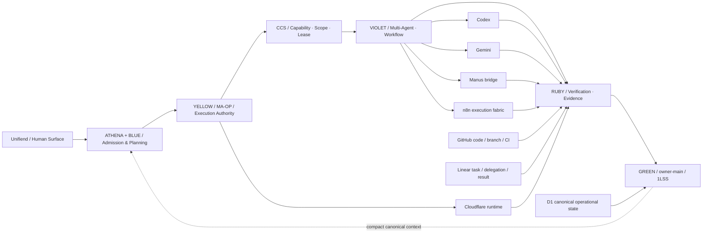

# OGENIC / Unifiend — System Architecture Map

This is the **human first-view** architecture. It intentionally compresses OGE-1..80+ into functional domains so the control path is visible before implementation detail.

## Reading the map

The solid center line is the authority/canonical path:

**Unifiend -> ATHENA/BLUE -> YELLOW -> CCS -> VIOLET -> RUBY -> GREEN/1LSS**

Parallel work can fan out under VIOLET, but execution authority does not fan out with it. Results must return through Ruby before canonical promotion.

See:
- [Functional grouping](./OGE_SYSTEM_GROUPS.md)
- [Machine-readable edges](./oge-system-edges.json)
- [Unifiend embed contract](./UNIFIEND_EMBED.md)
- [Standalone SVG](../../public/architecture/oge-system-map.svg)
