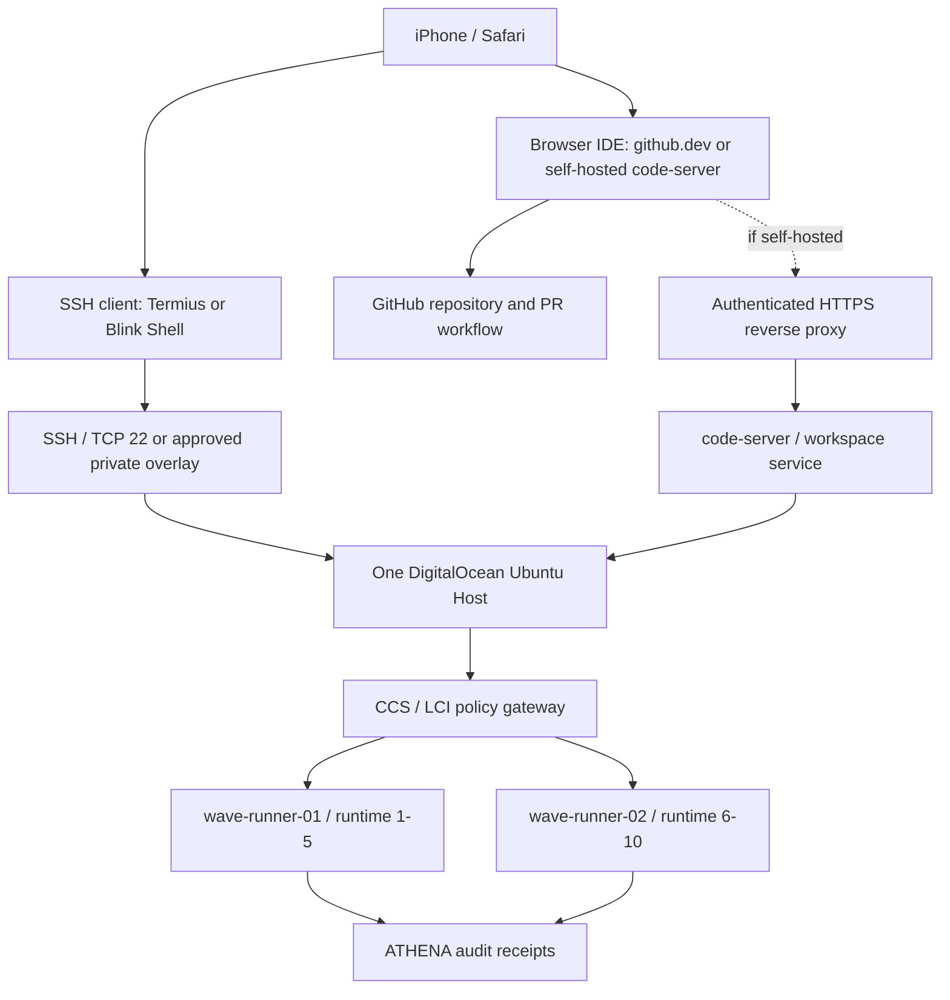

# WAVE Mobile IDE + SSH Terminal Entry — integration guideline

Status: **PROPOSED / NOT DEPLOYED**. Documentation-only. Canonical implementation branch: `phase-vi-provider-incentive-metering`. This document does not authorize host, network, secrets or production changes.

## Mobile-first topology

## Definitions

- **Terminal**: a command interface; **SSH**: secure remote transport. An iPhone SSH app presents a terminal connected to the Ubuntu host.
- **IDE**: code editing/debugging environment; `github.dev` edits GitHub files in the browser, while `code-server` runs an IDE service on the host and needs authenticated HTTPS/private access.
- **LCI**: validated local command/tool interface, not a substitute for SSH, Terminal or IDE.
- **SUDO**: privilege escalation governed by host sudoers; not implicitly granted by SSH, IDE or a GitHub runner.

## Mobile options

| Route | Phone usage | Host install | Security/limits |
| --- | --- | --- | --- |
| Termius / Blink Shell | iOS SSH terminal | Existing SSH server | Key-based login; host fingerprint verification; never commit private SSH keys |
| GitHub `github.dev` | Safari browser editor | None | Browser editor; no local host terminal; changes via GitHub auth |
| `code-server` | Safari browser IDE | Requires explicit owner-approved installation | HTTPS/private overlay + auth; bind localhost/private interface, not unauthenticated public 0.0.0.0 |

## Phase 1: read-only verification before installation

1. Confirm host and both runner registrations; one Ubuntu host, separate runner service/work directories. Do not create a second VM.
2. Confirm `sshd` is running and host-key fingerprint using a trusted owner channel. Do not paste SSH private keys into GitHub, issues, chat, or logs.
3. Check which IDE services are **already installed** before proposing `code-server` or equivalent.
4. Verify `whoami`, `id`, `git --version`, `gh --version`, `command -v code-server`, `sudo -n -l` (may fail without NOPASSWD; that is evidence, not permission to change sudoers).
5. Verify workspace paths and existing GitHub Actions runner service names; do not assume the host name equals runner name.
6. Record sanitized verification to ATHENA after its adapter is confirmed; never log secrets.

## Permission and change gates

- GS and GT can request IDE, Terminal, LCI and approved SUDO operations via CCS. Neither agent inherits unrestricted root.
- Use scoped operations and explicit approval for installation, firewall changes, sudoers, secrets, live service restart and production deployment.
- No `sudo -E` default, arbitrary `shell=True` execution, public unauthenticated IDE, or production Infisical secret injection for staging tasks.
- This guide is not a claim that SSH login, web IDE, LCI, Runner-2 or ATHENA has been tested end-to-end.

## Owner mobile setup checklist

1. SSH: install a trusted iOS client (Termius or Blink); add DigitalOcean host IP/domain, SSH username and a securely stored private key; verify server fingerprint before first connection.
2. IDE now: use `https://github.dev/Ogenicchocolate21debug/Build-Platform` in Safari for GitHub editing (repository permissions required).
3. IDE on host later: inspect existing services first; only then approve private HTTPS `code-server` deployment if needed.
4. Integrate the verified endpoints as **LCI adapters** in the existing CCS architecture; do not create a parallel control plane.
