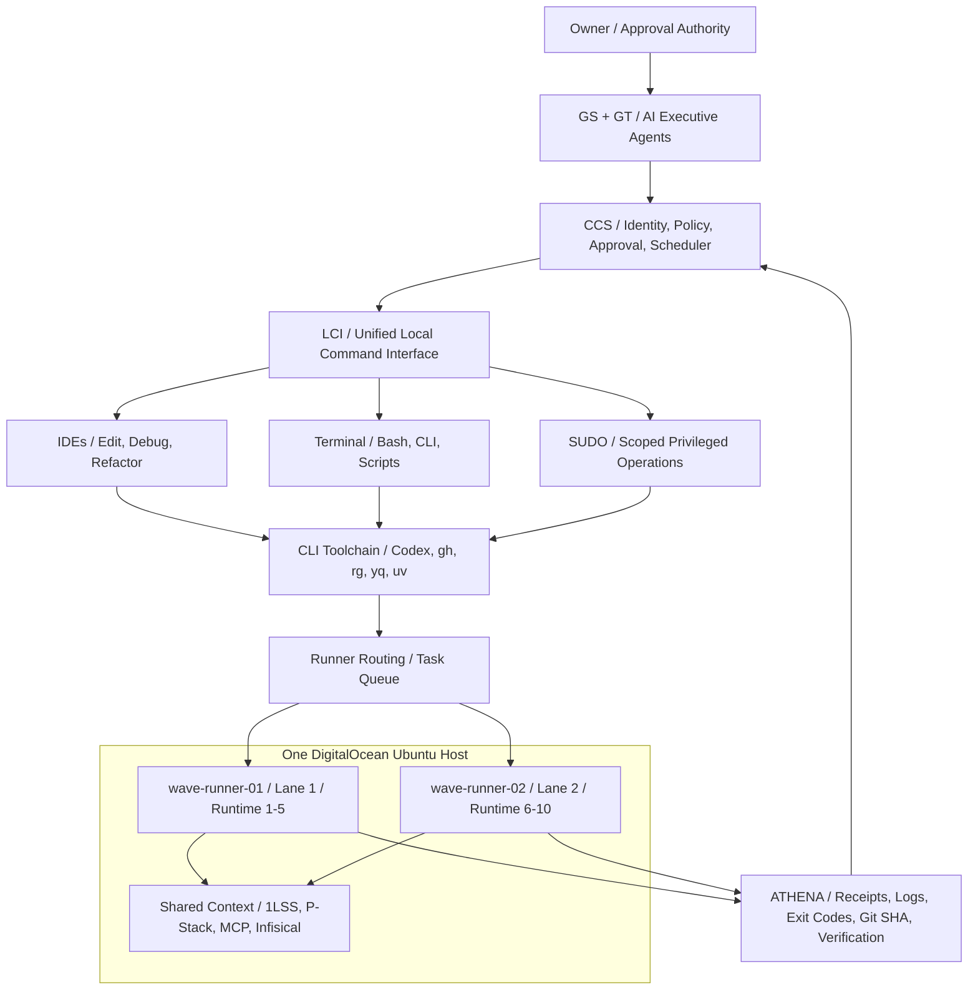

# OGENIC WAVE — Unified Command Architecture (Guideline)

> **Status:** Architecture guideline, not evidence that every component is deployed or authorized. Documentation only. No production permission is granted by this document.

## Diagram

## Responsibility and access model

| Layer | Responsibility | Permission boundary |
| --- | --- | --- |
| GS / GT | Plan, request and review work | No implicit root privileges |
| CCS | Identity, policy, owner approvals, routing, idempotency | Single authorization decision point |
| LCI | Tool registry and validated execution adapters | Never bypass CCS |
| IDEs | Read/edit/refactor/debug workspace | Workspace-bound, task-scoped |
| Terminal | Run allowed commands and scripts | Structured argv, no arbitrary remote shell by default |
| SUDO | Host service/container/network maintenance | Allowlisted operations and least-privilege sudoers; owner approval for high-risk changes |
| CLI Toolchain | Codex, GitHub CLI, Infisical, Wrangler, rg, yq, uv, Docker Compose | Per-tool credentials and task policy |
| wave-runner-01 | Lane 1 / runtime slots 1–5 | Distinct runner registration, service and work directory |
| wave-runner-02 | Lane 2 / runtime slots 6–10 | Distinct runner registration, service and work directory |
| ATHENA | State checks and immutable-style evidence receipts | Evidence verification independent of executor claims |

## Operating constraints

- Exactly **one physical Ubuntu/DigitalOcean host** is intended; two GitHub self-hosted runner services share approved context and infrastructure. Runner-2 existence/registration must be verified on host, not inferred from this document.
- Both runners may invoke IDEs, Terminal, LCI and scoped SUDO when authorized; lanes denote scheduling ownership, **not exclusive tool ownership**.
- Ten logical runtime slots do not guarantee ten simultaneous GitHub Actions jobs. Concurrency is constrained by runner services and host CPU/RAM.
- `sudo -E`, passwordless sudo and `shell=True` are **not** blanket authorization. Do not expose arbitrary privileged shell commands through an unauthenticated API.
- Infisical CLI installation does not establish machine identity or secret access. Use environment-scoped, least-privilege secret injection; never print secret values.
- Staging operations remain staging-only unless the Owner explicitly authorizes a separate production change. Documentation updates do not authorize deployment.
- A successful command exit is not sufficient proof of runtime state: record post-action verification and ATHENA receipts.
- Changes to production, secrets, sudoers, host security policy, or live deployment require explicit, separately scoped authorization.

## Implementation status

This file is the **canonical design guideline proposal**, not an assertion that LCI, Runner-2, ATHENA, machine identity or full sudo policy have been implemented or live-tested. Validate each against the actual Ubuntu host and staging workflows before marking PASS.
