# OGE-82 — Closure Evidence

## RESULT
Bounded delegation · lineage revocation · invocation-time authorization · egress scope.

## CHANGED
Canonical artifacts for this issue are present on `phase-vi-provider-incentive-metering`.

## TESTS
For hardening lanes OGE-80..84, GitHub PR verification passed:
- Validate and Bundle OGENIC Phase VI — run 149 / `37714740729`
- OGE-67 MA-OP Web Lab Proof — run 27 / `37714740742`
- hardening behavioral tests, root typecheck/build, MA-OP core/bridge and CCS smoke all passed

For architecture lanes OGE-85..87, canonical Markdown/Mermaid/SVG assets are stored under `docs/architecture/` and `public/architecture/`.

## EVIDENCE
- Canonical branch: `phase-vi-provider-incentive-metering`
- Final verification merge: `100da69639dc5585fdb97a2073619b5b7de79236`
- PR: #11 for OGE-84 final canonical verification

## RESIDUAL RISK
This visual summarizes verified repository evidence; it does not claim production deployment or modify main/production/Candy/D1 schema.
