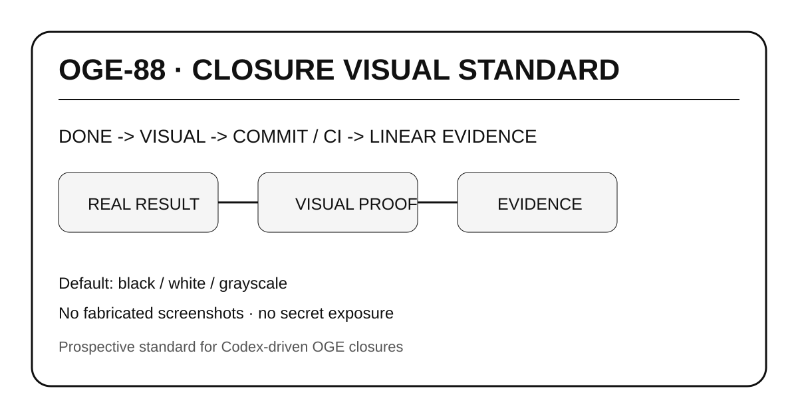

# OGE-88 — Closure Visual Standard

## RESULT
A prospective repository standard now requires one human-readable visual evidence artifact for future OGE closures when a truthful visual is available.

## CHANGED
- Added closure visual standard.
- Added reusable README and SVG templates.
- Added agent operating-rule requirement.
- Added this first evidence package.

## TESTS
- SVG is valid XML by construction.
- All closure README required sections are present.
- No secret values are embedded.

## EVIDENCE
Canonical repository paths under `docs/evidence/` on `phase-vi-provider-incentive-metering`.

## RESIDUAL RISK
This standard governs future closures. Historical OGE issues are not retroactively complete merely because this template exists.
