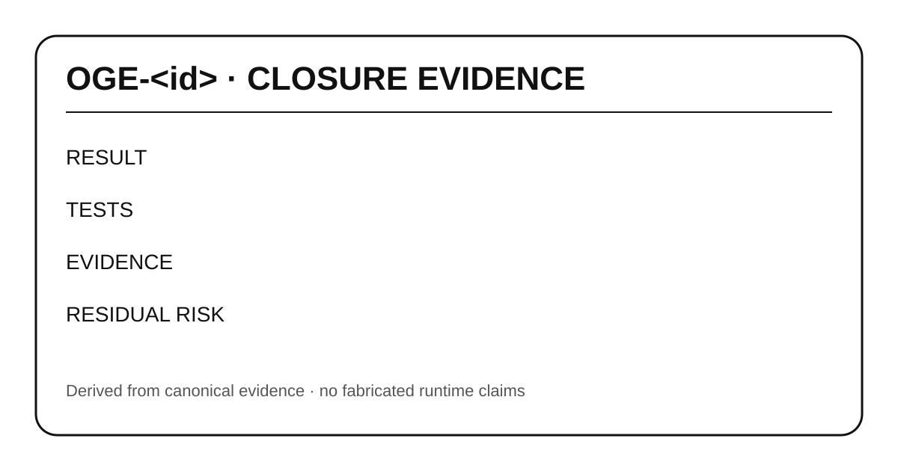

# OGE-<id> — Closure Evidence

## RESULT
Describe the verified outcome.

## CHANGED
List the smallest canonical changes.

## TESTS
List exact test/build/runtime checks.

## EVIDENCE
Link commit, CI, runtime or source evidence.

## RESIDUAL RISK
State what remains uncertain or intentionally deferred.
