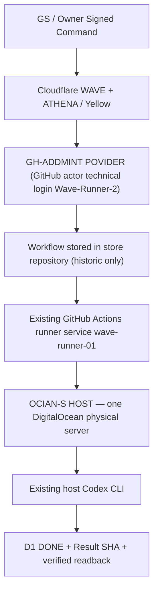
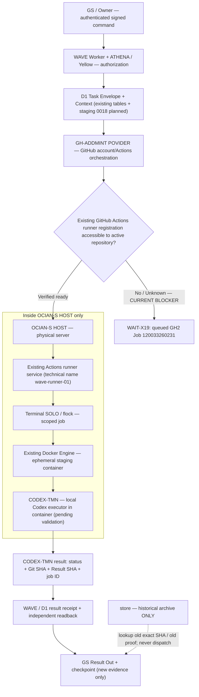

# OWNER CANONICAL MAP — 23 October 2026
## GH-ADDMINT POVIDER / store / CODEX-TMN / OCIAN-S HOST

**Status: DESIGN + SOURCE POLICY. Docker CODEX-TMN from active GitHub repository and D1 E2E still NOT VERIFIED.**
**Canonical display labels are exact as ordered:** `GH-ADDMINT POVIDER`, `store`, `CODEX-TMN`, `OCIAN-S HOST`.
Technical external identifiers remain `Wave-Runner-2/Build-Platform`, `Ogenicchocolate21debug/Build-Platform`, registered runner service `wave-runner-01`, and DigitalOcean Droplet technical name `OCIAN-S-Host`. The technical labels are **not additional GitHub Providers or separate hosts**.

## A. HISTORIC VERIFIED path — 22 Oct 2026

Evidence: `store` workflow Run `39702219051`, Job `119573896324`, actor `Wave-Runner-2`, result `OGE129_SIGNED_OWNER_TO_RUNNER_CODEX_D1_E2E=PASS`. This green is preserved. **Separate** Docker historical Run `39124078680` used `docker run --rm --network none --read-only` on that same original server, including a root Codex profile audit. It does not establish Docker was the executor for GS→D1 Run39702219051.

## B. OWNER-REQUIRED CURRENT target — no additional host

**Legend:** Solid chain is REQUIRED flow, **NOT** a claim of current E2E PASS. The guarded diamond is currently unverified. `store` is archive-only and cannot execute new tasks. The Docker container is required by Owner but **not yet demonstrated on GH-ADDMINT POVIDER current workflow**.

## Why routing changed, and what was wrong

1. GitHub is **source control, code/PR versioning, account authorization, Actions workflow scheduling and audit evidence**. GitHub Cloud is not the physical CODEx engine. The self-hosted Actions *runner service* resides on OCIAN and executes jobs scheduled by GitHub.
2. Previous Actor was already the active GitHub account `Wave-Runner-2`, but workflow YAML lived in what is now named `store`. Owner reclassified `store` as historical-only, so **future workflows should be hosted and dispatched from active GH-ADDMINT POVIDER technical repository**.
3. The preceding edit redirected Worker dispatch to the new repo **before** verifying that the original OCIAN runner service was registered and authorized for that new repo. Consequently GH2 smoke Run `39838575588` was still QUEUED; this is an unsatisfied migration dependency, not proof Codex failed.
4. The next error was omitting Docker from the runtime architecture. Historic `39124078680` is Docker proof; current PR#10 scripts still use host `codex exec`, so they do **NOT** yet meet the Owner-mandated `Docker → CODEX-TMN` requirement.
5. Repair means **keep one physical OCIAN server, its existing GitHub Actions runner process, existing Codex login and Docker installation**; verify compatible active repository binding/labels, then stage containerized CODEX-TMN with safe user/workspace/auth mounts, memory budget, and D1 receipt validation. No new physical runner, second Codex account, or separate Docker host.

## Order of proof (strict)

- Prove existing registered runner is online/accessible for active repo. The hosted GitHub token's runner inventory API returned `403` which means permissions unknown; not an offline verdict.
- On OCIAN only, read Docker Engine version, existing local images, existing Codex CLI/profile metadata (NO credentials), RAM and service ownership. Since host is 1GB RAM, only one bounded ephemeral task at a time using the existing Terminal SOLO lock.
- Prove a safe read-only Docker `CODEX-TMN` smoke **actually runs** after workflow dispatch from active GH-ADDMINT POVIDER; no re-authentication or secret export.
- Connect signed WAVE→Task Context→Docker→CODEX-TMN→Result→D1 independent readback. Match source SHA, Task ID, context revision, Run/Job, result hash and time. Only then label E2E.
- **No merge, deploy, Docker image build, container start, secret change, or host runner re-registration was executed by this documentation.** Keep all historic green/orange immutable.
